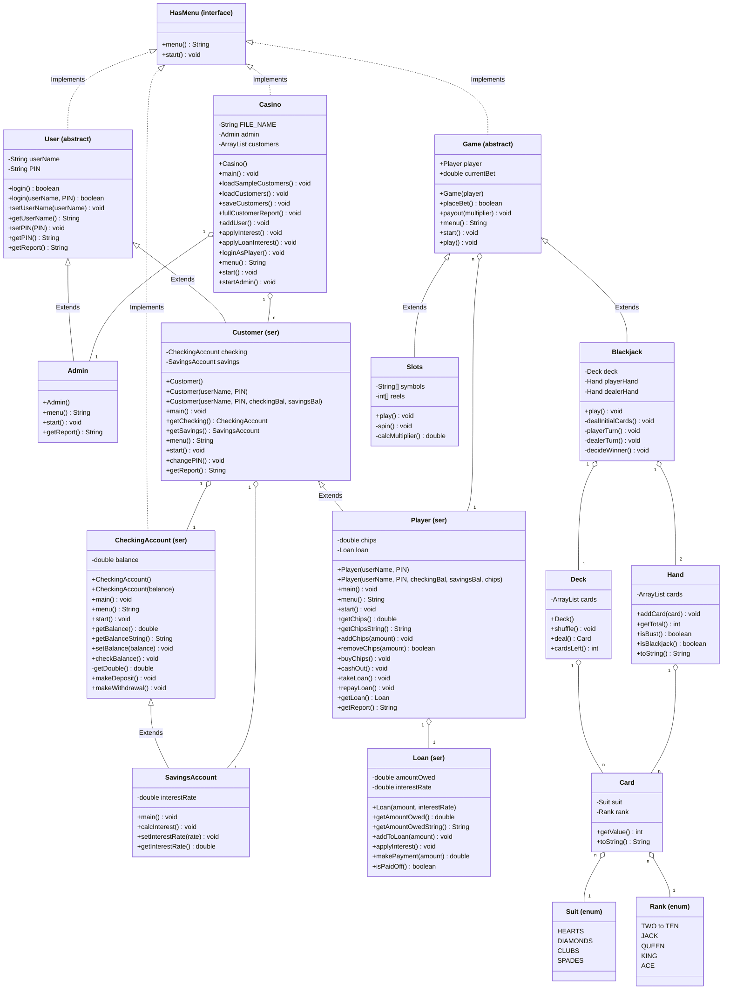

# Casino Final Project Proposal

Christian Livingston, CSCI 121 — Java final project

## Purpose

Demonstrates object-oriented programming, abstract data types and data structures from CSCI 121 by extending my ATM project into a text-based casino for fun.

## Overview

A text based casino where players use chips to play Blackjack and Slots. It builds on my ATM code: each player is also a bank customer, so they buy chips from checking, cash out winnings, and can take out a loan. Player data is saved between runs.

## Game Classes

- Game (abstract): holds the Player and the bet, handles betting and payouts, and requires each game to implement play().
- Blackjack: plays a round against the dealer using a Deck and two Hands.
- Slots: spins the reels and pays out on matching symbols.
- Cards, Deck, and Hand: model the cards, the 52-card deck, and a hand's total.
- Might add roulette, but it will depend on how the other stuff goes

## Other Classes

- Player extends Customer, adding chips, a Loan, and buying and cashing out chips.
- Loan: tracks the amount owed and its interest.
- Casino: replaces Bank and handles login, the admin menu, and saving.
- Reused from the ATM: HasMenu, User, Admin, Customer, CheckingAccount, SavingsAccount.

## Anticipated Use Cases

- Players: log in, buy chips, play games, cash out, and take or repay a loan.
- Admin: view reports, add users, and apply interest.

## Use of Object-Oriented Programming Paradigms

14 classes, one interface, and two enums:

- Inheritance: Player extends Customer; Blackjack and Slots extend Game.
- Encapsulation: all data members are private.
- Polymorphism: Blackjack and Slots implement play() differently.
- Abstraction: HasMenu is an interface; Game and User are abstract.
- Aggregation: Casino holds a list of Customers.
- Composition: Blackjack owns its Deck and Hands.

## Use of Data Structures

- ArrayList of Customers holds every user.
- The Deck is an ArrayList of Cards, shuffled and dealt from the end.
- Arrays hold the slot reels.
- Serialization saves all players.

## Technology / Implementation

Written in Java with a command-line menu, using interfaces, abstract classes, enums and object serialization. No external dependencies.

## UML Diagram

